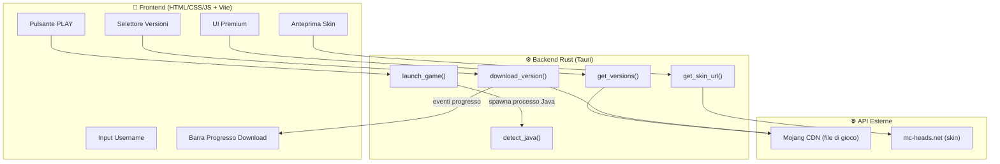
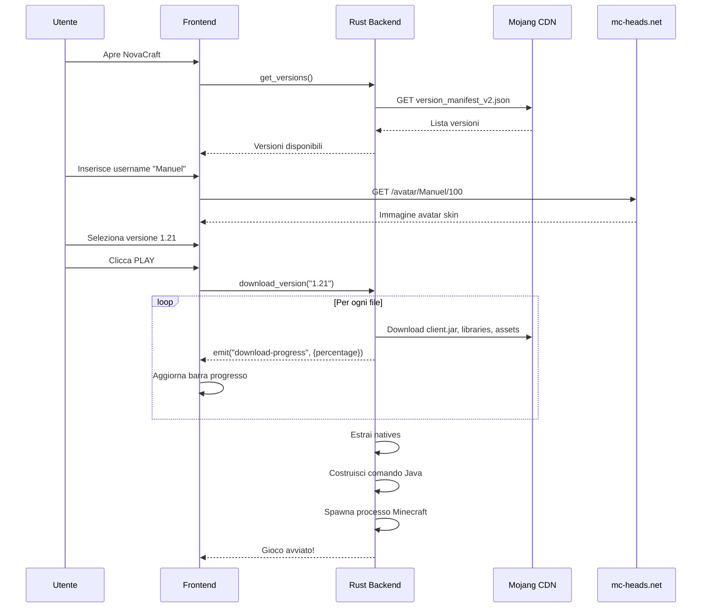

# NovaCraft Launcher — Piano di Implementazione

Un launcher Minecraft moderno, leggero e open-source costruito con **Tauri v2 (Rust)** e un frontend premium in **HTML/CSS/JS + Vite**. Questa prima versione ("Base") include: download delle versioni, inserimento username, visualizzazione skin e avvio del gioco in modalità offline.

## Architettura Generale



## Flusso di Funzionamento



---

## Proposed Changes

### Setup Progetto

#### [NEW] Progetto Tauri + Vite

Creeremo il progetto nella cartella `c:\Users\Manuel\Desktop\NovaCraft-Launcher\` usando `npm create tauri-app`.

**Struttura finale del progetto:**
```
NovaCraft-Launcher/
├── src-tauri/                      # Backend Rust
│   ├── src/
│   │   ├── main.rs                 # Entry point
│   │   ├── lib.rs                  # Setup app + registrazione comandi
│   │   ├── commands.rs             # Tutti i comandi Tauri
│   │   ├── minecraft/
│   │   │   ├── mod.rs              # Re-export moduli
│   │   │   ├── manifest.rs         # Parsing version_manifest_v2.json
│   │   │   ├── downloader.rs       # Download client, libraries, assets
│   │   │   ├── libraries.rs        # Gestione librerie + regole OS
│   │   │   ├── assets.rs           # Download asset index + oggetti
│   │   │   ├── natives.rs          # Estrazione native libraries
│   │   │   └── launch.rs           # Costruzione comando + avvio Java
│   │   └── utils.rs                # UUID offline, rilevamento Java, helper
│   ├── Cargo.toml
│   ├── tauri.conf.json
│   └── capabilities/default.json
├── src/                            # Frontend
│   ├── index.html                  
│   ├── styles/
│   │   ├── main.css                # Design system + variabili CSS
│   │   ├── components.css          # Stili componenti (bottoni, card, ecc.)
│   │   └── animations.css          # Micro-animazioni + transizioni
│   ├── js/
│   │   ├── app.js                  # Logica principale dell'app
│   │   ├── api.js                  # Wrapper per i comandi Tauri (invoke)
│   │   └── ui.js                   # Manipolazione DOM + aggiornamento UI
│   └── assets/
│       └── logo.svg                # Logo NovaCraft
├── package.json
└── vite.config.js
```

---

### Backend Rust — Moduli Core

#### [NEW] `src-tauri/src/minecraft/manifest.rs`
Gestione del **Version Manifest** di Mojang:
- Fetch di `https://piston-meta.mojang.com/mc/game/version_manifest_v2.json`
- Parsing JSON → lista di `VersionInfo { id, type, url }`
- Filtraggio per tipo: `release`, `snapshot`, `old_beta`, `old_alpha`

#### [NEW] `src-tauri/src/minecraft/downloader.rs`
Download manager centralizzato:
- Download con verifica SHA-1 di ogni file
- Skip automatico se il file esiste già con hash corretto (deduplicazione)
- Emissione eventi `download-progress` al frontend con: nome file, bytes scaricati, totale, percentuale

#### [NEW] `src-tauri/src/minecraft/libraries.rs`
Gestione delle librerie Java:
- Parsing dell'array `libraries` dal version JSON
- Valutazione delle `rules` (logica OS-specifica: allow/disallow per windows/osx/linux)
- Costruzione dei path locali partendo da `downloads.artifact.path`
- Download di tutte le librerie necessarie per l'OS corrente

#### [NEW] `src-tauri/src/minecraft/assets.rs`
Download degli asset di gioco:
- Fetch dell'asset index JSON (suoni, texture, icone)
- Download degli oggetti nella struttura hash-based: `assets/objects/<2 char>/<full hash>`
- Deduplicazione automatica basata su hash SHA-1

#### [NEW] `src-tauri/src/minecraft/natives.rs`
Estrazione delle librerie native:
- Identificazione dei JAR nativi per l'OS corrente (`.dll` su Windows)
- Estrazione in `versions/<version>/natives/`
- Esclusione di META-INF e file non binari

#### [NEW] `src-tauri/src/minecraft/launch.rs`
Costruzione del comando di lancio e avvio del gioco:
- Sostituzione di tutti i placeholder (`${auth_player_name}`, `${classpath}`, ecc.)
- Costruzione del classpath completo (tutte le librerie + client.jar)
- Supporto argomenti moderni (1.13+) e legacy (pre-1.13, campo `minecraftArguments`)
- Generazione UUID v3 offline: `MD5("OfflinePlayer:" + username)`
- Argomenti JVM: memoria, natives path, launcher brand
- Spawn del processo `javaw.exe` con tutti i parametri

#### [NEW] `src-tauri/src/utils.rs`
Utilità generali:
- `offline_uuid(username)`: genera UUID v3 per modalità offline
- `detect_java()`: cerca installazioni Java nel sistema (JAVA_HOME, PATH, percorsi comuni)
- `get_minecraft_dir()`: ritorna il path `.minecraft` standard per l'OS

#### [NEW] `src-tauri/src/commands.rs`
Comandi Tauri esposti al frontend:

| Comando | Parametri | Ritorno | Descrizione |
|---|---|---|---|
| `get_versions` | - | `Vec<VersionInfo>` | Lista tutte le versioni disponibili |
| `download_version` | `version: String` | `Result<()>` | Scarica tutti i file per una versione + emette eventi progresso |
| `launch_game` | `version: String, username: String, ram_mb: u32` | `Result<()>` | Avvia Minecraft |
| `get_skin_url` | `username: String` | `String` | Ritorna URL avatar da mc-heads.net |
| `detect_java` | - | `Option<String>` | Cerca Java installato |

---

### Frontend — UI Premium

#### [NEW] `index.html`
Pagina principale con layout a pannello singolo:
- Sidebar sinistra con logo NovaCraft + navigazione
- Area centrale con selettore versione, avatar skin, username input, pulsante PLAY
- Barra progresso download animata

#### [NEW] `src/styles/main.css`
Design system completo:
- **Tema:** Dark mode con accenti viola/blu neon (palette: `#0a0a1a` sfondo, `#7c3aed` accento primario, `#06b6d4` accento secondario)
- **Tipografia:** Font "Inter" da Google Fonts
- **Glassmorphism:** Pannelli con `backdrop-filter: blur()` e bordi semitrasparenti
- **Variabili CSS** per colori, spacing, border-radius, ombre

#### [NEW] `src/styles/components.css`
Stili per tutti i componenti:
- Bottone PLAY gigante con gradiente animato e glow effect al hover
- Select box custom per le versioni con icone
- Input username stilizzato
- Card skin con bordo luminoso
- Progress bar con animazione di riempimento fluida
- Sidebar con effetto vetro

#### [NEW] `src/styles/animations.css`
Micro-animazioni premium:
- Fade-in all'avvio dell'app
- Pulse sul bottone PLAY
- Shimmer effect durante il caricamento delle versioni
- Animazione progresso download con gradient scorrevole
- Hover effects su tutti gli elementi interattivi

#### [NEW] `src/js/app.js`
Logica principale:
- Inizializzazione app (carica versioni, rileva Java)
- Gestione stato (versione selezionata, username, progresso download)
- Event listener per il bottone PLAY → download + lancio
- Listener eventi Tauri per `download-progress`

#### [NEW] `src/js/api.js`
Wrapper tipizzati per i comandi Tauri:
```javascript
import { invoke } from '@tauri-apps/api/core';
export const getVersions = () => invoke('get_versions');
export const downloadVersion = (version) => invoke('download_version', { version });
export const launchGame = (version, username, ramMb) => invoke('launch_game', { version, username, ramMb });
```

#### [NEW] `src/js/ui.js`
Manipolazione DOM:
- Popola il dropdown versioni
- Aggiorna l'immagine skin dall'URL mc-heads.net
- Aggiorna la barra di progresso in tempo reale
- Mostra/nascondi stati (scaricamento, pronto, in gioco)

---

## Dipendenze Rust (`Cargo.toml`)

| Crate | Uso |
|---|---|
| `reqwest` | HTTP client per download file e API |
| `serde` / `serde_json` | Serializzazione/deserializzazione JSON |
| `tokio` | Runtime asincrono (già incluso da Tauri) |
| `sha1` | Verifica integrità file scaricati |
| `md-5` | Generazione UUID v3 offline |
| `zip` | Estrazione JAR nativi |
| `tauri` | Framework app desktop |

---

## Cosa NON è incluso in questa versione base

> [!NOTE]
> Queste funzionalità verranno aggiunte in versioni future:
> - ❌ Installazione Forge/Fabric/Quilt
> - ❌ Gestione modpack (Modrinth/CurseForge)
> - ❌ Gestione istanze multiple
> - ❌ Download automatico di Java
> - ❌ Impostazioni avanzate JVM
> - ❌ Sistema skin custom (upload skin proprie)

---

## Open Questions

> [!NOTE]
> **✅ Cartella di gioco:** `%APPDATA%\NovaCraft` — cartella dedicata separata da `.minecraft` per evitare conflitti con altri launcher.

> [!NOTE]
> **✅ RAM di default:** 2GB (`-Xmx2G`) con slider nella UI per regolarla.

---

## Verification Plan

### Automated Tests
- `cargo build` — verifica che il backend Rust compili senza errori
- `npm run build` — verifica che il frontend compili
- `cargo tauri dev` — avvia l'app in modalità sviluppo

### Manual Verification
1. Avvio dell'app → la lista versioni si carica correttamente
2. Inserimento username → l'avatar skin appare
3. Selezione versione + click PLAY → la barra di progresso avanza
4. Download completato → Minecraft si avvia in modalità offline
5. Verifica che il gioco funzioni con il nome utente scelto
